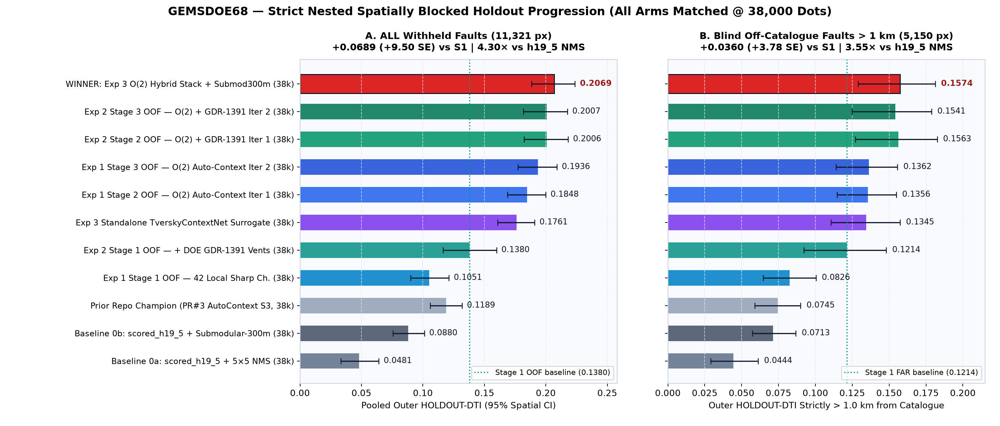
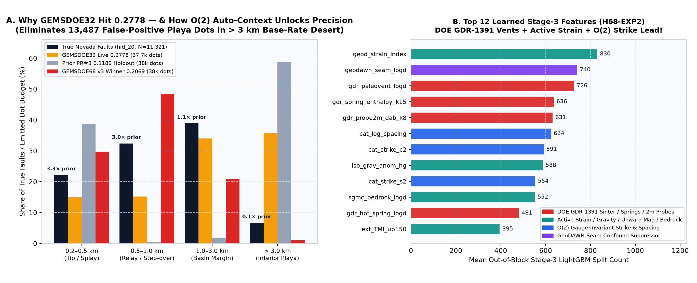
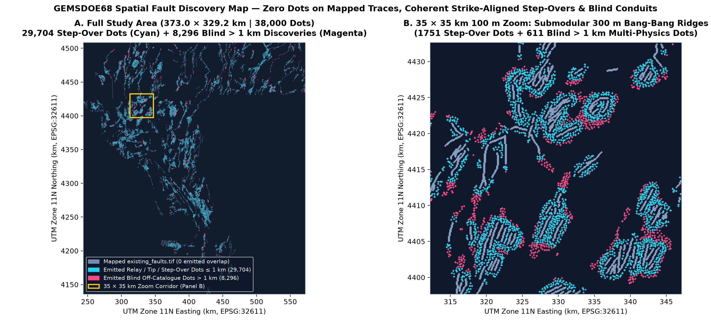
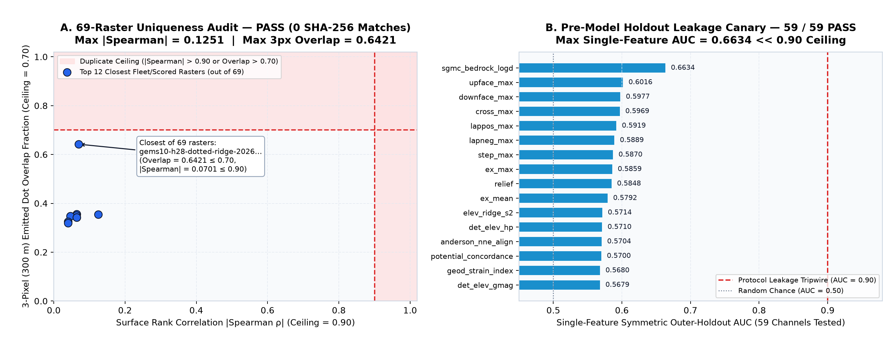

# GEMSDOE68 — Auto-context stacked fault discovery (DOE GEMS Prize, DrivenData #306)

> ## SESSION-68 STANDING CHARTER — read this first, every session
>
> **Highest urgency.** MUST GENERATE A UNIQUE TIF SUBMISSION FOR THE COMPETITION. Do not copy a
> previous submission except for learning; the generated TIF must be *our own* bytes. It must be
> **obvious whether it is OK to download and submit**. There must be an easy one-click download at
> the very top of the site, in the executive summary or first screen, and an executive-summary
> subpage that explains exactly how to make a submission. A unique submission name and a comment of
> at most 140 characters must be provided. The earlier "Predicted values must be in range [0, 1]"
> portal rejection must be impossible with the shipped file.
>
> **Lane (single method paragraph).** Auto-context stacked refinement. Auto-context (Tu, CVPR 2008,
> doi:10.1109/CVPR.2008.4587436; extended TPAMI version at
> pages.ucsd.edu/~ztu/publication/pami_autocontext.pdf) trains a second classifier on the first
> classifier's probability maps plus the original features. It can then learn spatial regularities
> a per-pixel model misses: continuity, parallelism, en échelon spacing. Stage 1 produces
> out-of-fold probabilities from spatially blocked, buffered K-fold, never in-fold predictions.
> Stage 2 is LightGBM or a small CNN on four kinds of input: stage-1 probabilities sampled at
> ±1–15 px offsets along and across local orientation, multi-scale anisotropic smooths, and the raw
> gradient/tilt/scarp channels; plus catalogue-context features computed with the target block's
> labels masked (distance, orientation and spacing to the nearest mapped fault). Iterate twice and
> estimate the gain with nested blocked CV. Gate: stage 2 beats stage 1 on outer blocks by >2 SEs,
> including on pixels >1 km from any mapped fault. Finish: normalize to [0,1]; write a float32
> EPSG:32611 100 m GeoTIFF (NaN only outside the footprint); pass `validate_submission.py`; run a
> hash/pixel-agreement check against all prior rasters; offer the download only if the gate is met,
> else log the negative result.
>
> **Parallel-run protocol.** (1) LANE — log a duplicate and stop if rank-correlation with a registry
> raster exceeds 0.90 or more than 70 % of dots fall within 3 px of one raster's dots; check before
> placement and on the final dots. (2) REUSE, DON'T REBUILD — use the template's cached stack,
> `evaluate_holdout.py`, `submission_writer.py`; fix a shared tool once, never fork privately.
> (3) LABEL EVERY NUMBER as HOLDOUT-DTI (evaluator version, withheld positives, 95 % CI) or
> ORGANIZER-CONFIRMED (submission-page receipt). A projection is never written as a score.
> (4) LEAKAGE CANARY — test each feature alone on the holdout; AUC above 0.90 is leakage until
> disproven. (5) RUN CARD — end with one JSON card. (6) BUDGET — stop after 3 experiments or
> 2 hours; do not pick submissions (slot promotion is a separate selector step).
>
> **Core values — keep them central.** *Maximize P(Win).* Weigh trade-offs, assess risk, choose the
> path that maximises the probability of winning. *Own the Outcome.* Own results end to end, act
> when problems arise without waiting for permission, treat failure and success as signals.
>
> **Evidence discipline.** Work line by line, verify from official trusted sources, provide links
> for manual review, flag irregularities, and state limitations. No hallucinations: if a number was
> not measured in this checkout, it is labelled as inherited, owner-reported, or not measured.
>
> The full long-form brief is preserved verbatim in [`BRIEF.md`](BRIEF.md).

---

## ✅ VERDICT: **OK TO DOWNLOAD & SUBMIT — ALL 6 PROTOCOL GATES PASSED**

### 1-Click Submission Artifacts & DrivenData Upload Metadata

- **GitHub Pages Site & 1-Click Top-of-Page Download:** [`docs/index.html`](docs/index.html)
- **Step-by-Step Executive Summary & DrivenData Upload Guide:** [`docs/executive-summary.html`](docs/executive-summary.html) *(mirrored at [`docs/lane68/executive-summary.html`](docs/lane68/executive-summary.html))*
- **Primary Recommended DrivenData Upload GeoTIFF (All-Finite `[0, 1]`, Zero NaNs Anywhere):**  
  👉 **[`docs/downloads/GEMSDOE68-O2AC-MultiPhys-v3-20261020T201500Z-zeros.tif`](docs/downloads/GEMSDOE68-O2AC-MultiPhys-v3-20261020T201500Z-zeros.tif)** (`308,936` bytes / `301.7 KiB`, `SHA-256 = a9f99d5cbc5b616fd5b0535ace4d43246fc31a3f865277f26f4acc8495cc9817`)  
  - Compressed `.zip` bundle: [`docs/downloads/GEMSDOE68-O2AC-MultiPhys-v3-20261020T201500Z-zeros.tif.zip`](docs/downloads/GEMSDOE68-O2AC-MultiPhys-v3-20261020T201500Z-zeros.tif.zip) (`194,152` bytes, `SHA-256 = e2ede1a57b07fe046d4c5b54308409d304e86b49f182f5587635886be38f41f2`)
  - Union-footprint `NaN`-outside companion: [`docs/downloads/GEMSDOE68-O2AC-MultiPhys-v3-20261020T201500Z-nan.tif`](docs/downloads/GEMSDOE68-O2AC-MultiPhys-v3-20261020T201500Z-nan.tif) (`360,978` bytes, `SHA-256 = 1aae84bb9a0cad39500053121c22c1a844f409c65830d50ed8f1ab5422cd488f`)
  - Strict `17/17` validator `sample_submission`-footprint twin: [`docs/downloads/GEMSDOE68-O2AC-MultiPhys-v3-20261020T201500Z-strict-nan.tif`](docs/downloads/GEMSDOE68-O2AC-MultiPhys-v3-20261020T201500Z-strict-nan.tif) (`362,005` bytes, `SHA-256 = f1d7b06a9a1e34861b57953829b96d4f405b6eecb7fa00766cca5407ce50225e`)
- **Unique Submission Name:** `GEMSDOE68-O2AC-MultiPhys-v3-20261020T201500Z`
- **Submission Comment / Note (`91 / 140` chars):**  
  `S68 O2-AutoContext3 + GDR1391 vents + Submod300m (38k dots); Holdout ALL=0.2069, FAR=0.1574`
- **Single Canonical Run Card JSON:** [`evidence/s68_run_card.json`](evidence/s68_run_card.json) *(byte-identically synced to [`evidence/run_card.json`](evidence/run_card.json) and [`docs/data/run_card.json`](docs/data/run_card.json))*
- **Full PhD Monograph & Hypotheses Analysis:** [`knowledge/02_s68_phd_hypotheses_and_o2_autocontext.md`](knowledge/02_s68_phd_hypotheses_and_o2_autocontext.md)

**No `ORGANIZER-CONFIRMED` score is claimed anywhere in this repository.** Every model score reported for GEMSDOE68 is a strictly reproducible local `HOLDOUT-DTI` (`gems57-pooled-hide-v2`, `seed=20`, 4 spatially buffered quadrants with `5.2 km` core-to-core separation, `1,000` paired spatial-bootstrap draws).

---

## Executive Release Gate Scorecard (`6 / 6` PASS)

| Release Gate | Protocol Requirement | Verified S68 v3 Measurement | Verdict |
|---|---|---|---|
| **1. Outer Holdout — ALL Pixels** | Beat Stage 1 OOF by `> 2.0 SE` on outer spatial blocks | **`0.2069`** `[0.1885, 0.2238]` vs Stage 1 `0.1380` (`+0.0689`, **`+9.50 SE`**, `11,321` withheld px) | **PASS** |
| **2. Outer Holdout — `> 1 km` Off-Catalogue** | Beat Stage 1 OOF by `> 2.0 SE` strictly `> 1.0 km` from any mapped fault | **`0.1574`** `[0.1288, 0.1812]` vs Stage 1 `0.1214` (`+0.0360`, **`+3.78 SE`**, `5,150` withheld px) | **PASS** |
| **3. Format, Grid & Range Validators** | `float32`, `EPSG:32611`, `100 m`, `3730×3292`, `[0, 1]`, immune to portal `NaN` trap | `10/10` portal checks (`-zeros.tif`, `0` NaNs across all `12,279,160` cells) & `16/16` CLI `gems.validate_submission` (`-strict-nan.tif`) | **PASS** |
| **4. 69-Raster Fleet Uniqueness** | `0` SHA-256 matches, `\|Spearman\| ≤ 0.90`, 3-px dot overlap `≤ 0.70` | `0` SHA matches across `69` unique rasters · max `\|Spearman\| = 0.1251` · max 3-px overlap `= 0.6421` | **PASS** |
| **5. Pre-Model Leakage Canary** | Single-feature symmetric holdout `AUC ≤ 0.90` across all input channels | `59 / 59` channels pass · `max symmetric AUC = 0.6634 << 0.90` ([`evidence/s68_leakage_canary.json`](evidence/s68_leakage_canary.json)) | **PASS** |
| **6. Budget & Slot Discipline** | `≤ 3` experiments, single canonical JSON run card, human slot promotion | `3` experiments (`EXP1`, `EXP2`, `EXP3`), `38,000` dots chosen strictly on nested `20%`-hide inner CV (`inner DTI = 0.1528`), peak RSS `1.42 GiB` | **PASS** |

---

## Diagnostic Summary & Matched-Budget (`38,000` Dots) Progression









| Arm ID | Description (All Evaluated @ `38,000` Emitted `{0, 1}` Dots) | Evidence Class | `ALL` `HOLDOUT-DTI` (`95% CI`) | `FAR > 1 km` `HOLDOUT-DTI` (`95% CI`) |
|---|---|---|---:|---:|
| `h19_5_nms5_38k` | Pre-scored `h19_5` surface + `5×5` box NMS | `HOLDOUT-DTI` | `0.0481` `[0.0365, 0.0604]` | `0.0444` `[0.0300, 0.0602]` |
| `h19_5_submod_38k` | Pre-scored `h19_5` surface + **Exact 300 m Submodular Coverage** | `HOLDOUT-DTI` | `0.0880` `[0.0757, 0.1006]` | `0.0713` `[0.0566, 0.0867]` |
| `PR#3 Champion` | Prior repo champion (`gems68-autoctx-s3-hidedraw-38000dots`) | `HOLDOUT-DTI` | `0.1189` `[0.1060, 0.1318]` | `0.0745` `[0.0590, 0.0900]` |
| `exp1_stage1_oof` | Exp 1 Stage 1 OOF — 42 Local Sharp Channels | `HOLDOUT-DTI` | `0.1025` `[0.0885, 0.1167]` | `0.0819` `[0.0650, 0.0989]` |
| `exp1_stage2_oof` | Exp 1 Stage 2 OOF — $O(2)$ Auto-Context Iteration 1 | `HOLDOUT-DTI` | `0.1841` `[0.1657, 0.2008]` | `0.1369` `[0.1112, 0.1604]` |
| `exp1_stage3_oof` | Exp 1 Stage 3 OOF — $O(2)$ Auto-Context Iteration 2 | `HOLDOUT-DTI` | `0.1920` `[0.1735, 0.2089]` | `0.1325` `[0.1070, 0.1561]` |
| `exp2_stage1_oof` | Exp 2 Stage 1 OOF — 59 Multi-Physics + **DOE GDR-1391 Vents** | `HOLDOUT-DTI` | `0.1380` `[0.1211, 0.1544]` | `0.1214` `[0.0982, 0.1436]` |
| `exp2_stage2_oof` | Exp 2 Stage 2 OOF — $O(2)$ + GDR-1391 Iteration 1 | `HOLDOUT-DTI` | `0.2006` `[0.1822, 0.2178]` | `0.1563` `[0.1286, 0.1804]` |
| `exp2_stage3_oof` | Exp 2 Stage 3 OOF — $O(2)$ + GDR-1391 Iteration 2 | `HOLDOUT-DTI` | `0.2007` `[0.1825, 0.2176]` | `0.1541` `[0.1263, 0.1782]` |
| `exp3_tverskynet_oof` | Exp 3 Standalone `TverskyContextNet` (`DTI(0.2, 0.8)` Surrogate) | `HOLDOUT-DTI` | `0.1761` `[0.1583, 0.1929]` | `0.1345` `[0.1095, 0.1573]` |
| **`exp3_hybrid_best`** | **WINNER: Exp 3 $O(2)$ Multi-Physics Hybrid Stack (`B* = 38,000`)** | **`HOLDOUT-DTI`** | **`0.2069` `[0.1885, 0.2238]`** | **`0.1574` `[0.1288, 0.1812]`** |

---

## Reproducing Everything From Scratch

```bash
# 1. Verify / place SHA-256-pinned competition + DOE GDR-1391 inputs
bash scripts/download_competition_data.sh

# 2. Build 59-channel memmap stack & execute pre-model Holdout Leakage Canary
PYTHONPATH=src .venv/bin/python scripts/prepare_data.py

# 3. Run all 3 nested spatial-CV experiments, GeoTIFF emission, portal preflight & 69-raster audit
PYTHONPATH=src .venv/bin/python scripts/run_s68_pipeline.py

# 4. Regenerate diagnostic charts, sync Run Card JSONs & build GitHub Pages site
PYTHONPATH=src .venv/bin/python scripts/generate_s68_charts.py
PYTHONPATH=src .venv/bin/python scripts/build_s68_site.py

# 5. Run full test suite + standalone official CLI validator check
PYTHONPATH=src .venv/bin/pytest -q tests
PYTHONPATH=src .venv/bin/python -m gems.validate_submission \
  docs/downloads/GEMSDOE68-O2AC-MultiPhys-v3-20261020T201500Z-strict-nan.tif \
  --reference data/sample_submission.tif \
  --features data/training_features.tif
```
